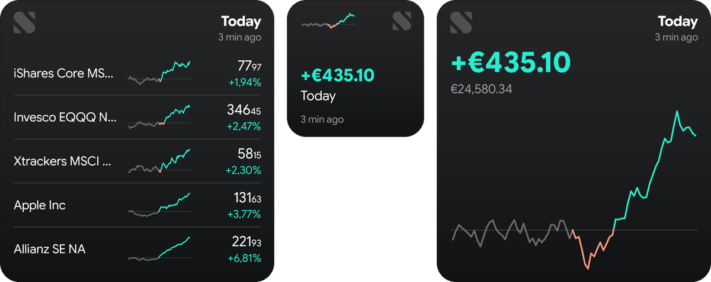
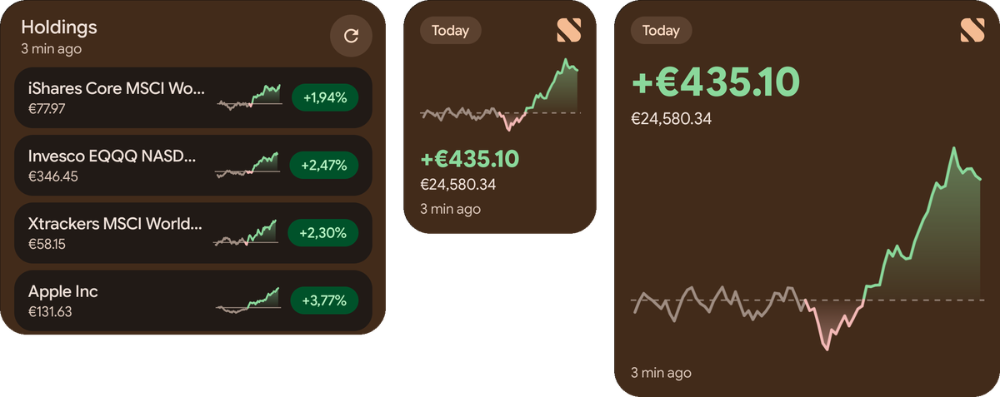
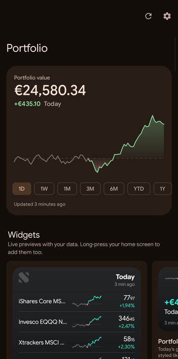
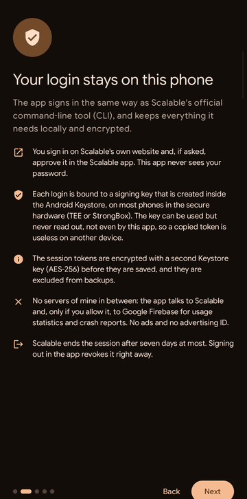
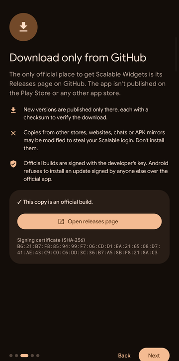

# Scalable Widgets

Home screen widgets for your [Scalable Capital](https://de.scalable.capital) portfolio on Android, in Scalable's iOS look or in Material You.

> Unofficial app. Not made, endorsed or supported by Scalable Capital.




| App | Login security | Official downloads |
|:---:|:---:|:---:|
|  |  |  |

## Features

- Portfolio and positions widgets in two styles, adapting to any widget size
- Show your holdings, your watchlist or a list of titles you pick
- Background refresh; tapping a widget opens the app, refreshes it or opens the Scalable app
- English, German and Italian
- Read-only: it can't trade or change anything in your account

## Download

Only from the [Releases page](https://github.com/AlexZorzi/ScalableWidgets/releases). Copies from anywhere else may be modified to steal your login.

Official builds are signed with this certificate (SHA-256):

```
B6:21:B7:F8:85:94:99:F7:06:CD:D1:EA:21:65:08:D7:41:AE:43:C9:C0:C6:DD:3C:36:B7:A5:8B:F8:21:8A:C3
```

## Setup

1. On the Scalable website, enable **Profile → Security → Agentic Investing** and enable CLI.
   

3. Open the app, tap **Connect**, confirm the code in the browser and approve the login on your phone if asked.
4. Long-press your home screen and add the widgets.

Scalable ends these sessions after seven days, so you'll need to sign in again once a week.

## Security and privacy

- Login uses the same OAuth device flow as Scalable's official [CLI](https://github.com/ScalableCapital/scalable-cli). The app never sees your password.
- Each session is bound to a key generated in the Android Keystore (hardware-backed on most phones) that can't be exported.
- Tokens are encrypted with a second Keystore key and excluded from backups.
- The app talks only to Scalable, plus Firebase usage statistics and crash reports if you allow them (Settings → Privacy). No portfolio data is ever sent.

## Building

```
./gradlew assembleDebug
```

Optional, both git-ignored:

- `app/google-services.json` from your own Firebase project enables analytics and crash reports
- `keystore.properties` with `storeFile`, `storePassword`, `keyAlias` and `keyPassword` signs release builds

Publishing a GitHub release tagged like `v1.2.3` builds a signed APK and attaches it to the release (see `.github/workflows/release.yml`).

## Support

If you find it useful: [PayPal](https://www.paypal.com/paypalme/alexzorzi) · [Ko-fi](https://ko-fi.com/allesss)

## License

[GPL-3.0](LICENSE). Third-party notices in [NOTICE](NOTICE).
